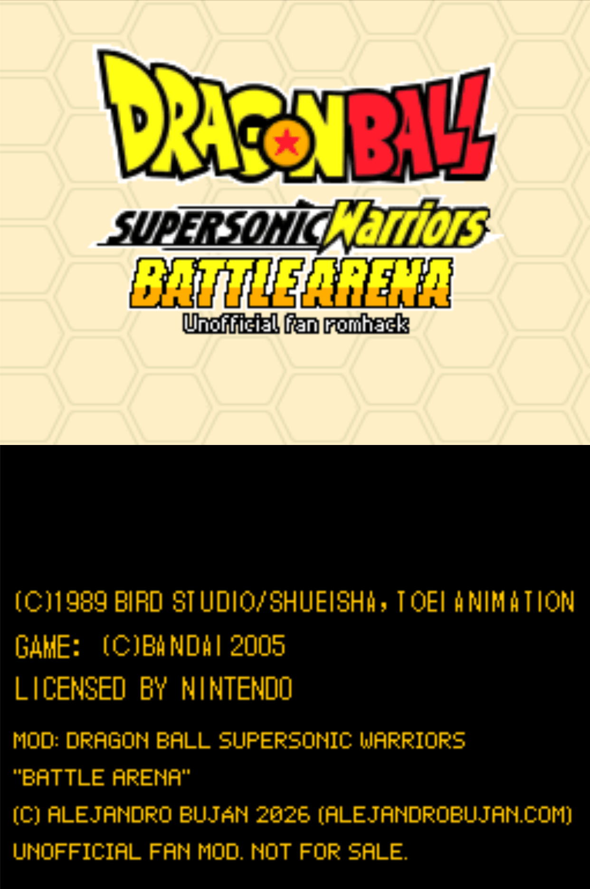

<h1 align="center">Dragon Ball Supersonic Warriors “Battle Arena”</h1>

  <em>Fan romhack of <b>Dragon Ball Z: Supersonic Warriors 2</b></em> 
  Nintendo DS · Europe

  
  
  

  <a href="https://github.com/alejandrobujan/dbsw-battle-arena/releases/latest"><b>Download v1.2.2</b></a>
  &nbsp;·&nbsp; <a href="https://www.romhacking.net/hacks/10080/">Romhacking.net</a>
  &nbsp;·&nbsp; <a href="#english">English</a>
  &nbsp;·&nbsp; <a href="#español">Español</a>
  &nbsp;·&nbsp; <a href="#license--licencia">License</a>

© 2026 <a href="https://alejandrobujan.com">Alejandro Buján</a>

> [!NOTE]
> Unofficial fan mod. Not for sale. Not affiliated with or endorsed by Bandai Namco,
> Toei Animation, Bird Studio/Shueisha or Nintendo. This repository contains only a
> patch: you need your own copy of the game.

## English

A pure fighting version of Supersonic Warriors 2: the game boots straight into Free
Battle team select and never leaves it. The battle engine is the original one.

Several new characters never seen in the original Supersonic Warriors games are
waiting to be unlocked in battle. Find out who they are.

Also listed on [Romhacking.net](https://www.romhacking.net/hacks/10080/).

### What's new in 1.2.2

- Fixed: the Team Arts portraits of the new characters had no white frame separating them.
- Fixed: the new characters' faces in the team boxes and the VS screen covered the corners of their
  frames.
- Fixed: new characters based on Super Saiyan Vegeta turned into Majin Vegeta when their team had the
  support that triggers it.
- Fixed: characters were recoloured when fighting an opponent built on the same base character.
- Fixed: characters built on the same base character could not be in the same team.
- Fixed: bugs that made some already unlocked characters impossible to use.
- Fixed: a main character could not be used because a support character duplicated it.
- Fixed: some parts of the new characters' ki blasts used the normal colours instead of their own.
- Fixed: new characters could take part in Team Arts meant for their base character.

### What's new in 1.2.1

- Fixed: new characters' auras, ki blasts and special moves used their base character's colours
  instead of their own.

### What's new in 1.2

- Improved sprites for several characters.
- Better framing for some character icons.

### How to patch

1. You need a dump of **your** cartridge of *Dragon Ball Z: Supersonic Warriors 2*
   (Europe), game code `ADBP`. It must match:

   | | |
   |---|---|
   | SHA-1 | `6681ae01620e736d7428f4bbd84b2388134d5c2b` |
   | MD5 | `dffae2dfce8cb052197094d488b96042` |
   | CRC32 | `0e001277` |

2. Apply [`patch/DBSW-BattleArena-v1.2.2.xdelta`](patch/DBSW-BattleArena-v1.2.2.xdelta) to it with any xdelta tool:
   - [Rom Patcher JS](https://www.marcrobledo.com/RomPatcher.js/) (in a browser)
   - Delta Patcher (Windows / macOS / Linux)
   - command line: `xdelta3 -d -s original.nds DBSW-BattleArena-v1.2.2.xdelta battle_arena.nds`
3. The patched ROM must match:

   | | |
   |---|---|
   | SHA-1 | `6c8b8e110722bef8be3eafecfa60211680fb7146` |
   | MD5 | `a47fca91aab3e6e8e663ec1b01bae06e` |

4. Play it on a flashcart or an emulator (melonDS, DeSmuME…).

### Credits & reuse

If you build on this hack (a patch on top of it, a port, a video, a translation…),
please credit **Alejandro Buján** ([alejandrobujan.com](https://alejandrobujan.com)) and
link this repository. That is also what the license below asks for.

### Contributing & contact

Contributions are very welcome: bug reports, ideas, new characters, art, translations.
Open an issue or write to **[hi@alejandrobujan.com](mailto:hi@alejandrobujan.com)**.

## Español

Una versión de puro combate de Supersonic Warriors 2: el juego arranca directamente
en la selección de equipos de Free Battle y no sale de ahí. El motor de combate es el
original.

Unos cuantos personajes nuevos, inéditos en la saga original de Supersonic Warriors,
esperan a ser desbloqueados combatiendo. Descubre quiénes son.

También está en [Romhacking.net](https://www.romhacking.net/hacks/10080/).

### Novedades de la 1.2.2

- Arreglado: los retratos de Team Arts de los personajes nuevos no tenían el marco blanco que los
  separa.
- Arreglado: las caras de los personajes nuevos en los recuadros del equipo y del VS tapaban las
  esquinas del marco.
- Arreglado: los personajes nuevos con base Vegeta Super Saiyan se convertían en Majin Vegeta cuando
  el equipo llevaba el support que lo provoca.
- Arreglado: los personajes se recoloreaban al combatir contra rivales de la misma base.
- Arreglado: no se podían usar personajes de la misma base en el mismo equipo.
- Arreglado: errores que imposibilitaban el uso de ciertos personajes ya desbloqueados.
- Arreglado: un personaje principal no se podía usar por estar repetido en un personaje support.
- Arreglado: algunas partes de las ráfagas de ki de los personajes nuevos salían con los colores
  normales en vez de los suyos.
- Arreglado: los personajes nuevos podían participar en Team Arts de su personaje base.

### Novedades de la 1.2.1

- Arreglado: las auras, ráfagas de ki y ataques especiales de los personajes nuevos usaban los
  colores de su personaje base en vez de los suyos propios.

### Novedades de la 1.2

- Sprites mejorados para varios personajes.
- Mejor encuadre de algunos iconos de personajes.

### Cómo parchear

1. Necesitas un volcado de **tu** cartucho de *Dragon Ball Z: Supersonic Warriors 2*
   (Europa), código `ADBP`. Debe coincidir con:

   | | |
   |---|---|
   | SHA-1 | `6681ae01620e736d7428f4bbd84b2388134d5c2b` |
   | MD5 | `dffae2dfce8cb052197094d488b96042` |
   | CRC32 | `0e001277` |

2. Aplícale [`patch/DBSW-BattleArena-v1.2.2.xdelta`](patch/DBSW-BattleArena-v1.2.2.xdelta) con cualquier herramienta xdelta:
   - [Rom Patcher JS](https://www.marcrobledo.com/RomPatcher.js/) (en el navegador)
   - Delta Patcher (Windows / macOS / Linux)
   - línea de comandos: `xdelta3 -d -s original.nds DBSW-BattleArena-v1.2.2.xdelta battle_arena.nds`
3. La ROM parcheada debe coincidir con:

   | | |
   |---|---|
   | SHA-1 | `6c8b8e110722bef8be3eafecfa60211680fb7146` |
   | MD5 | `a47fca91aab3e6e8e663ec1b01bae06e` |

4. Juega en una flashcart o un emulador (melonDS, DeSmuME…).

### Créditos y reutilización

Si construyes sobre este hack (un parche encima, un port, un vídeo, una traducción…),
menciona a **Alejandro Buján** ([alejandrobujan.com](https://alejandrobujan.com)) y enlaza
este repositorio. Es también lo que pide la licencia de abajo.

### Colaboraciones y contacto

Las colaboraciones se agradecen mucho: avisos de fallos, ideas, personajes nuevos, arte,
traducciones. Abre un issue o escribe a **[hi@alejandrobujan.com](mailto:hi@alejandrobujan.com)**.

## License / Licencia

The original work in this hack (its changes to the game, code and new art) by Alejandro
Buján is licensed under
[**CC BY-NC-SA 4.0**](https://creativecommons.org/licenses/by-nc-sa/4.0/) (see [`LICENSE`](LICENSE)):
you may share and adapt it, giving credit, not for commercial purposes, and under the same
license. It does not cover the game itself, its characters or its original graphics,
which belong to their owners.

El trabajo original de este hack (sus cambios al juego, código y arte nuevo) de Alejandro
Buján tiene licencia
[**CC BY-NC-SA 4.0**](https://creativecommons.org/licenses/by-nc-sa/4.0/deed.es) (ver [`LICENSE`](LICENSE)):
puedes compartirlo y adaptarlo dando crédito, sin fines comerciales y con la misma licencia.
No cubre el juego en sí, sus personajes ni sus gráficos originales, que pertenecen a sus
dueños.

---

Dragon Ball © Bird Studio/Shueisha, Toei Animation. Supersonic Warriors 2 © Bandai 2005.
All trademarks belong to their owners. Made by a fan, for fans, free of charge.
